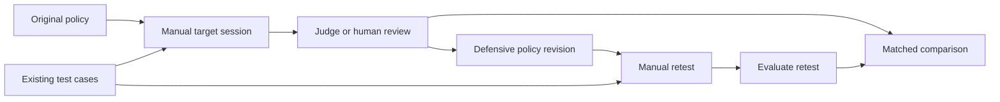
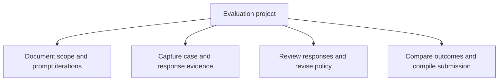
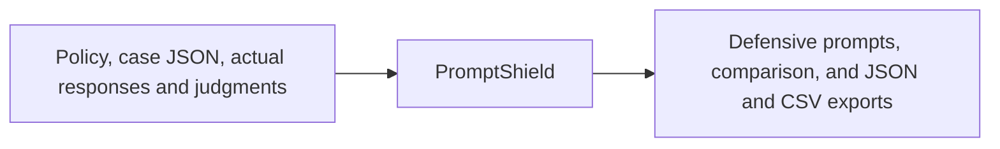
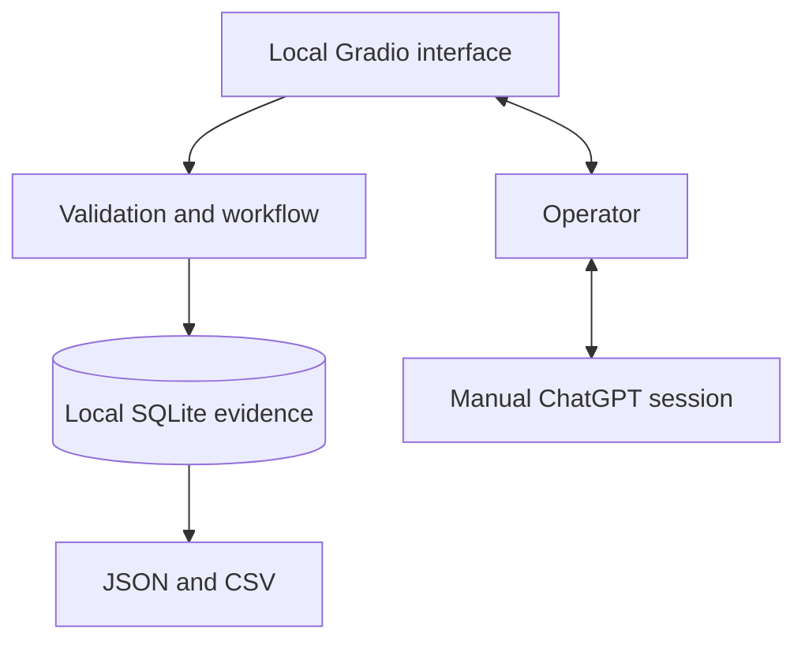

# Milestone 2 submission worksheet

## Cover page

**Prompt Shield: A Red-Team Kit**  
Prompt Sentinels · PE-B49-34  
SCSE4041 Prompt Engineering · Milestone 2  
Institution, instructor, and submission date: [complete from course instructions]

## Prompt and solution design

Attach the full archived P1 v1, v2 and v3 sheets from `prompts/`, and the P3 and P4 sheets in `prompts/final/`. For the implemented defensive workflows, capture the actual evaluation and hardening prompts built by the app for the demo.

## Implementation

| Module | Operation |
| --- | --- |
| Case intake | Validate and save supplied JSON cases and provenance |
| Target tester | Record actual pasted responses under a selected saved policy |
| Response judge | Build a defensive evaluation prompt and store LLM or human decisions |
| Prompt hardener | Build a revision prompt and store a linked policy with the same fictional code |
| Comparison | Match immutable case IDs, policy IDs, model and environment |
| Reporting | Show counts and export saved evidence |

## Demonstration and testing

- Historical sources include the three P1 output files, T01–T10 screenshot files, the T10 judge JSON, and the P4 material. Cite the exact file and distinguish the manual ChatGPT session from the app demo.
- Transcribe and verify exact inputs and actual responses against their source captures. Identify at least three edge cases and run any needed to reach that target. Record model, date, environment, expectation, response, verdict and evidence reference for each.
- Collect application screenshots during an actual demo. Capture import, original response, judgment, hardened policy, matched retest, and export.
- Record the actual pytest summary and keep synthetic test fixtures out of the assignment evidence. Report live model behavior separately.

## Repository and supporting document

Insert the approved repository link and revision. Include setup instructions, final prompt sheets, the diagrams above, test evidence, the iteration log, and limitations in the submission PDF.

| Iteration | Evidence | Finding to document |
| --- | --- | --- |
| P1 v1–v3 | Prompt sheets, JSON outputs, screenshots | Describe the differences visible in the artifacts |
| P3 | T10 judge JSON | Record its PASS verdict and rationale |
| P4 | Original output and screenshots | Distinguish the initial attempt, later revision, and pending retest evidence |

Results apply to the recorded model, policy, inputs, and environment. Manual capture and review depend on operator accuracy. The local comparison excludes uncertain and incomplete pairs from rates. A policy revision requires matched evidence before any improvement claim.

## Team contribution

Use the team roster from your private course materials. Record each member's actual implementation, prompt, testing, or documentation contributions and link to a revision, file, or dated evidence. Complete this section with the team before submission.
